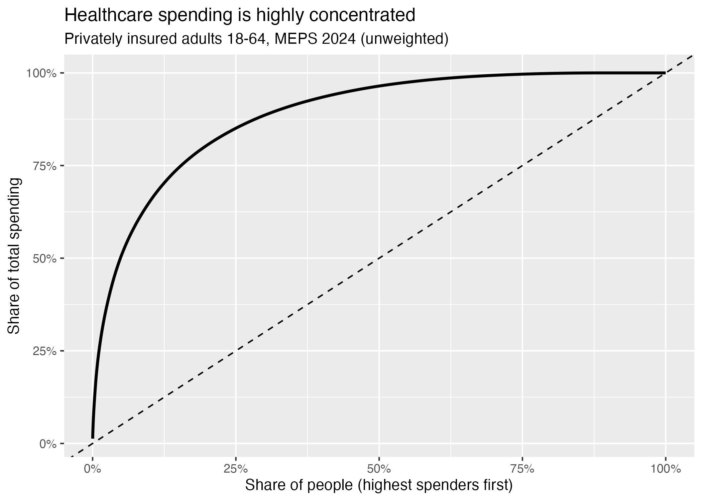
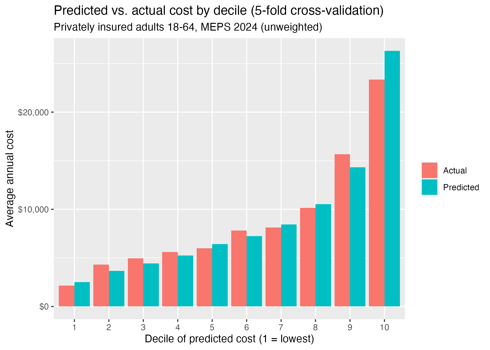

# Modeling Healthcare Costs and High-Cost Claimants (MEPS 2024)

## Business question
How should a health plan expect costs to vary across a privately insured adult
population, and how much does knowing members' chronic conditions improve
that expectation beyond age, sex, and region?

## Why it matters
Health insurers collect premiums before claims are paid, so pricing depends on
predicting who will cost what. Costs are heavily concentrated in a small group of
members, which drives risk adjustment, stop-loss (reinsurance) pricing, and the
sensitivity of premiums to the health mix of a population. This project measures
that concentration, builds a cost model, and translates results into the units
health actuaries use: per-member-per-month (PMPM) cost and stop-loss pure premium.

## Data
- Medical Expenditure Panel Survey (MEPS), 2024 Full Year Consolidated File (HC-256), AHRQ.
- Scope: privately insured adults aged 18-64 (`INSCOV24 == 1`, any private
  insurance), n = 7,027 after excluding 79 people with missing diagnosis answers.
  Children were excluded because the chronic-condition questions apply only to adults.
- Raw data is not included in this repo (see How to run).

## Key findings
1. **Costs are extremely concentrated.** The top 1% of people account for 24% of
   spending, the top 10% for 65%, and the bottom half for only 3.5%.

   

2. **Chronic conditions separate high- and low-cost people.** On a single 70/30
   holdout, actual cost in the top predicted decile was about 10x the bottom decile
   with chronic conditions in the model, versus about 2x with age, sex, and region
   alone. In 5-fold cross-validation, the top decile averaged about $23,300 and the
   bottom about $2,150 (~11x). Overall predicted cost was within about 1% of actual,
   though the top decile was over-predicted by about 13%.

   

3. **Chronic conditions drive cost in two ways.** People with 1-2 conditions are
   mainly more likely to use care; at 3+ conditions the effect is in how much they
   spend. Someone with 4+ conditions costs roughly 5x a comparable person with none.
   Much of the apparent age effect disappears once conditions are included
   (50-64 vs 18-34 falls from 2.3x to 1.3x among users).
4. **Stop-loss pricing.** Expected cost above a $100k per-person attachment point was
   about $91 per member per month in this sample (12% of total cost), a pure premium
   before expenses, margin, and trend. Above $250k it was about $21.50, but that rests
   on only 14 people and is not credible on its own.
5. **PMPM by health status:** about $394 (no chronic conditions) to $2,158 (4+).

## Method
- Two-part model: logistic regression for any spending, then gamma GLM (log link)
  for amount among people with spending. Expected cost = P(any spending) x E[cost | spending].
- Features: age band, sex, region, number of chronic conditions (12 diagnosis flags, capped at 4+).
- Validation: 5-fold cross-validated decile table (primary result); 70/30 holdout
  with decile comparison; and a 20-seed repeated-split calibration check
  (actual/expected mean 0.997, range 0.88-1.14).

## Limitations
- Self-reported survey data, not insurer claims; no benefit design (deductibles, copays).
- Unweighted analysis, so figures describe this sample, not the U.S. population.
- Conditions and spending are measured in the same year, so the model explains
  cost rather than predicting next year's cost. A prospective version using
  MEPS's two-year panel would be the natural next step.
- The condition count treats all conditions equally. Risk-adjustment models weight
  conditions by their cost, which would likely improve prediction.
- Extreme skew means tail estimates (for example, the $250k layer) rest on very few people.
- Gamma dispersion remains high (~6), so most individual-level variation is unexplained.

## How to run
1. Download the Stata version of HC-256 from the
   [MEPS website](https://meps.ahrq.gov/data_stats/download_data_files_detail.jsp?cboPufNumber=HC-256),
   unzip it, and place `h256.dta` in the project folder.
2. Run `01_clean.R`, then `02_model.R`.

Requires R with the `tidyverse` and `haven` packages.

## Files
- `01_clean.R`: load, clean missing-value codes, build cohort
- `02_model.R`: modeling, validation, stop-loss and PMPM tables
- `cv_deciles.csv`, `stop_loss.csv`, `pmpm_by_conditions.csv`: result tables
- `concentration_curve.png`, `decile_chart_cv.png`: charts